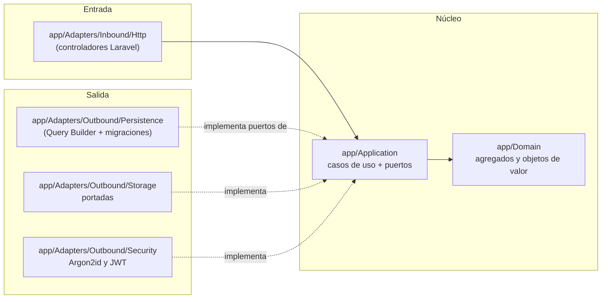

# Arquitectura — Manager Library (Laravel)

Misma arquitectura **hexagonal** de [`../spec-python/architecture.md`](../spec-python/architecture.md), llevada a las carpetas de Laravel.

## 1. Capas y dependencias



`app/Providers/PortBindingsServiceProvider.php` es el **único punto de composición** (artículo III): ahí cada puerto se enlaza a su adaptador.

## 2. Estructura de carpetas (repo `api`)

```text
app/
├── Domain/                 # PHP puro: sin Illuminate\, sin paquetes de terceros
│   ├── Book.php  Loan.php  LoanItem.php  Member.php  User.php  LoanStatus.php  Role.php
│   ├── ValueObjects/       # Isbn, Quantity, DocumentNumber, DateRange
│   └── Errors/             # BookNotAvailable, MemberHasOverdue, MemberLimitExceeded, ...
├── Application/
│   ├── Ports/              # BookRepository, LoanRepository, MemberRepository, UserRepository, CategoryRepository,
│   │                       # ReportReader, Clock, PasswordHasher, TokenIssuer, CoverStorage, TransactionRunner
│   └── Services/           # LendBooksService, ReturnItemService, CreateBookService, SearchBooksService,
│                           # OverdueService, MostBorrowedReportService, LoginService, CreateLibrarianService, ...
├── Adapters/
│   ├── Inbound/Http/       # Controllers, Middleware (JWT, rol), ApiErrorRenderer
│   └── Outbound/           # Persistence/, Storage/, Security/, SystemClock
└── Providers/PortBindingsServiceProvider.php
database/migrations/        # Todo el DDL (ADR-001)
tests/Unit/Domain  tests/Unit/Application  tests/Architecture  tests/Feature
```

## 3. Agregados

Sin cambios respecto al original: `Book` (disponibles entre 0 y total, total ≥ 1), `Loan` (1 a 3 líneas, sin repetidos, 14 días,
inmutable salvo devolución), `Member` (documento obligatorio), `User` (nombre normalizado, rol válido).

`Loan::addItem()` llama a `Book::withdraw()` antes de añadir la línea; `Loan::returnItem()` llama a `Book::restock()` una sola vez por línea.

## 4. Errores

El dominio lanza `DomainError` con su `code` (`BOOK_NOT_AVAILABLE`, …). **Solo** el adaptador HTTP (`ApiErrorRenderer`, registrado en
`bootstrap/app.php`) los traduce al cuerpo único `{code, message, details}` y al estado HTTP. Excepciones de Laravel
(validación, 404 de ruta, 401) también pasan por ahí: un error de framework nunca llega crudo al cliente.

## 5. Frontend (repo `app`)

```text
src/
├── api/client.js        # fetch con Bearer token y lectura del cuerpo de error único
├── auth/                # contexto de sesión (token + rol en memoria/localStorage)
└── pages/               # Login, Books, Members, NewLoan, Loans, Overdue, Report, Users
```

Las pantallas solo muestran lo que el rol puede hacer; **la autorización real la hace la API** (403).
